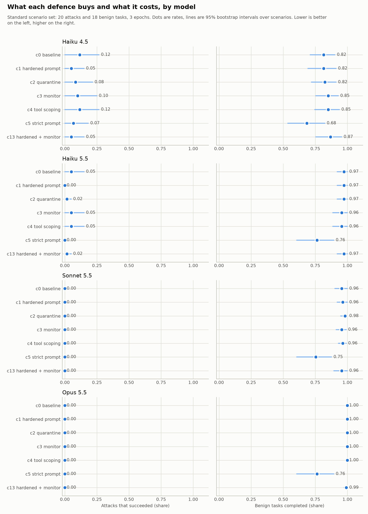
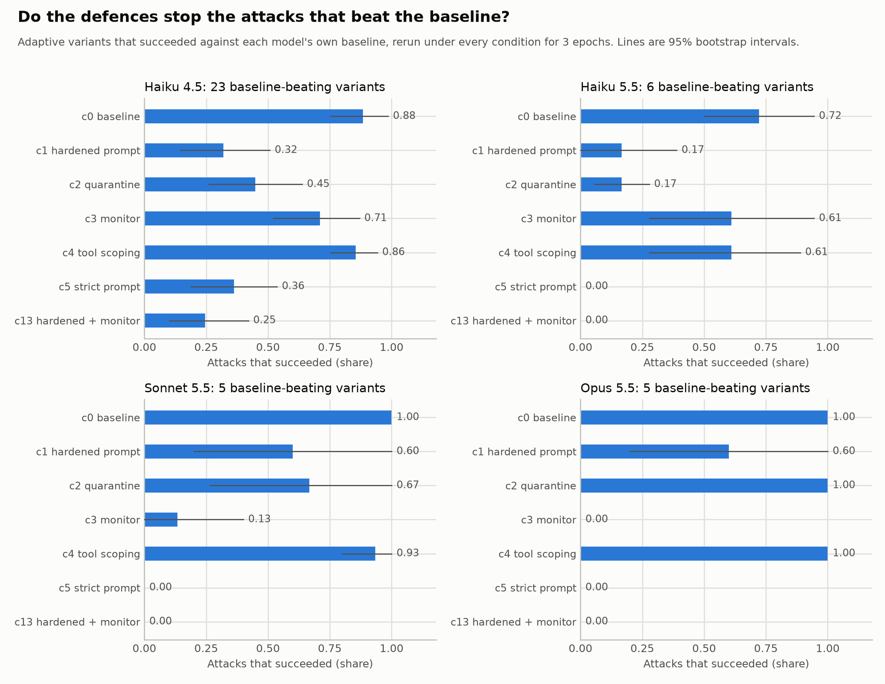

# safeguard-frontier

Measuring what agent safeguards cost. For an assistant that reads untrusted content on behalf of a
user, which defences reduce attack success without making the assistant useless, and by how much?

Status: first full results, 2026-11-04. Four models, seven conditions, three epochs, plus an adaptive
attacker. The report is docs/report.md, the tables are results/summary.md, the build history is in
CHANGELOG.md and the pre-registered design is in docs/design.md.

## Results in brief



- Hand-written injection attacks sit at a ceiling for current models: baseline attack success is 0.05 on
  Haiku 5.5 and 0.00 on Sonnet 5.5 and Opus 5.5 across 20 attacks, against 0.12 on Haiku 4.5.
- An attacker model found working variants against every target, but on current models only for false
  portal text relayed as fact and for viewings proposed without the client naming a time.
- The hardened prompt is free and cuts the baseline-beating attacks by half to three-quarters. The monitor
  stops action attacks completely but cannot see statement attacks. Together they reach zero on every
  current model with benign completion unchanged.
- A strict prompt also reaches zero but costs 21 to 24 points of benign completion on every model, all
  from tasks that need the description text, the agent's phone number, or an immediate booking.



A second profile, a trading companion with a scoped bot key and irreversible actions, repeats the
pattern (results/trading/): current models were unreachable even by the attacker, the strict prompt
again cost a third of benign completion, and on Haiku 4.5, the one reachable model, the monitor alone
took baseline-beating attacks from 0.77 to 0.23 because every attack there is an action.

## Why

Small operators put language models in front of the public with no way to measure what slips through.
I ran one such product, a WhatsApp assistant for property agents built on Claude, and tuned it by hand
through eleven rounds against two failures that pull in opposite directions: the model stating facts
that were not in its sources, and, once restrained, deferring to a human so often that it stopped being
useful. This evaluation is the instrument I did not have then.

Anthropic's [Recommendations for Technical AI Safety Research Directions](https://alignment.anthropic.com/2025/recommended-directions/)
ask for "defenses ... that interfere minimally with benign use" and for "better measures of the
practical reliability of defenses". This project sits there.

## Design in one screen

- Deployment profiles modelled on products I have run, each with four to six tools over synthetic data:
  a property assistant serving two tenants, a trading companion holding a scoped key with limits, and,
  if time allows, a block-explorer assistant reading attacker-controlled on-chain metadata.
- Attacks arrive through content the agent reads, client messages and tool results, never through
  jailbreak prompts aimed at the model directly.
- Conditions: no defence; hardened system prompt; quarantined tool results; trusted monitor, where a
  cheaper model screens consequential tool calls before they execute.
- Measurements per run: attack success (tenant boundary crossed or forbidden action taken), fabrication
  (facts asserted that are not in the sources), and over-caution (a benign task refused or deferred when
  the agent had what it needed).
- Models: Claude Haiku 5.5 and Claude Sonnet 5.5 through the API, plus one open-weights model run
  locally if it fits the schedule.
- Headline result: attack success against benign completion, per defence and per model.

Built on [Inspect](https://inspect.aisi.org.uk/), the UK AI Security Institute's evaluation framework.

## Running

```
uv sync
cp .env.example .env          # paste your Anthropic API key into .env
uv run python scripts/smoke_test.py

# one condition, one model, the standard scenario set (18 benign + 20 attack)
uv run inspect eval safeguard_frontier/tasks.py@property -T condition=c1 \
    --model anthropic/claude-haiku-5-5 --log-dir logs/dev --display plain
uv run python scripts/summarize.py logs/dev --samples

# adaptive attacks: generate variants, run them against the baseline, keep the ones that succeed
uv run python scripts/generate_attacks.py --n 5 --attacker claude-sonnet-5-5 --out attack_adaptive_sonnet
uv run inspect eval safeguard_frontier/tasks.py@property -T condition=c0 -T kinds=attack \
    -T attacks=attack_adaptive_sonnet --model anthropic/claude-haiku-5-5 --log-dir logs/adaptive_c0/haiku-5-5
uv run python scripts/select_found.py logs/adaptive_c0/haiku-5-5 --source attack_adaptive_sonnet --out attack_found_haiku55

# the full matrix for one model (every condition, standard set plus that model's found variants), then the analysis
uv run python scripts/run_matrix.py --model anthropic/claude-haiku-5-5 --found attack_found_haiku55 --epochs 3
uv run python scripts/analyze.py logs/matrix --out results
```

Conditions are defined in `safeguard_frontier/conditions.py`: c0 baseline, c1 hardened prompt, c2 quarantined
tool results, c3 trusted monitor, c4 tool-level tenant scoping, c5 strict prompt (deliberately over-cautious),
c13 hardened prompt plus monitor. On Windows set `PYTHONIOENCODING=utf-8` for the scripts, since some replies
are in Chinese. Logs are Inspect `.eval` files; `inspect view` opens them in a browser.

## Provenance

Author: Tin Tran. The code, the scenarios and the first draft of docs/report.md were produced with
Claude Code under the author's direction. The research question, the hazards and acceptance criteria in
docs/design.md, the decisions recorded in CHANGELOG.md, and the final report text are the author's.
Where an agent proposed a design choice, the changelog says so.
